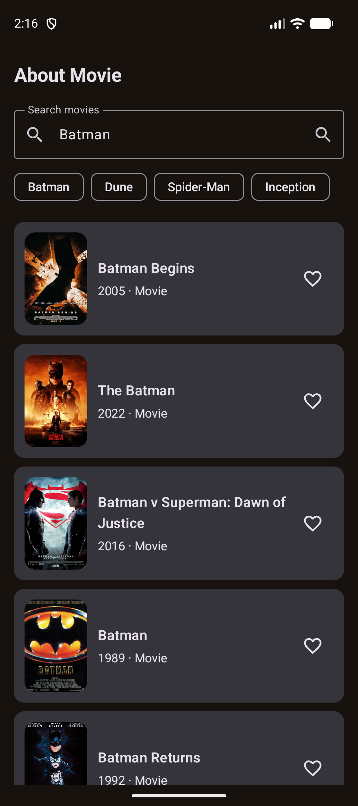
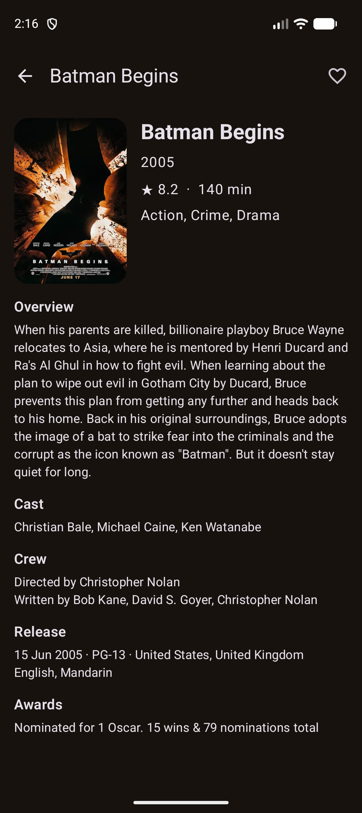
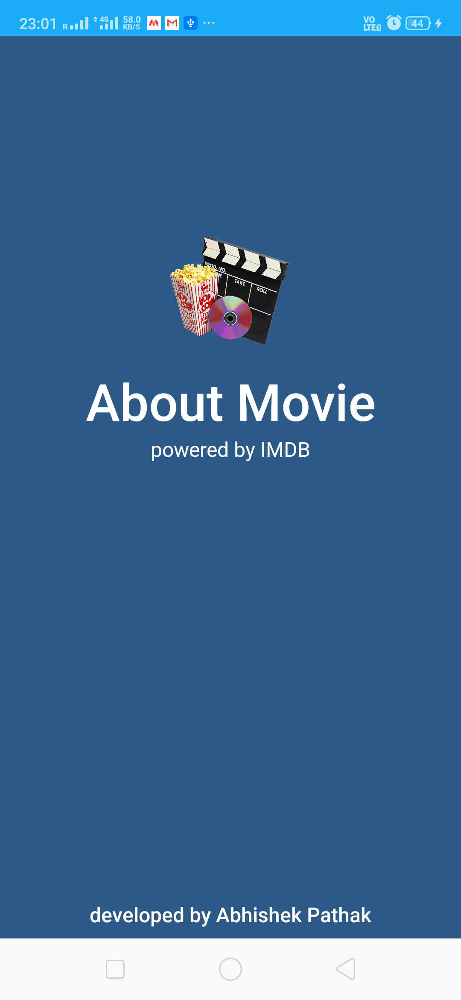
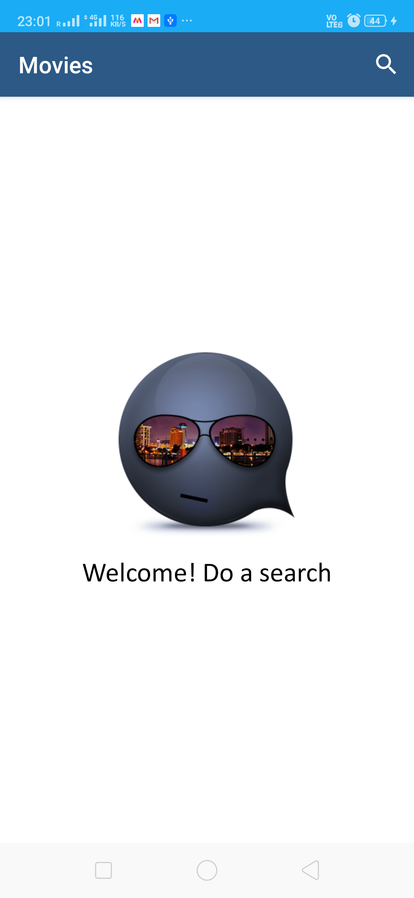
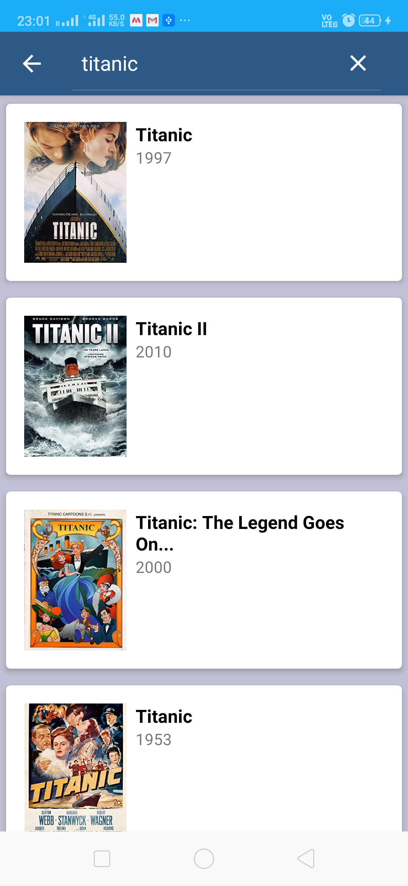
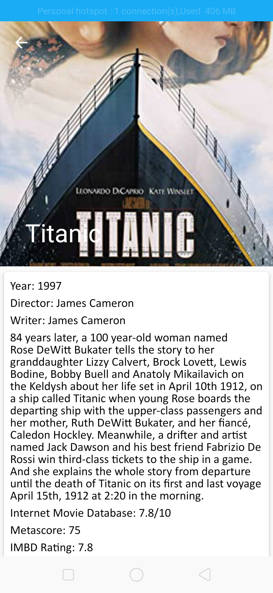
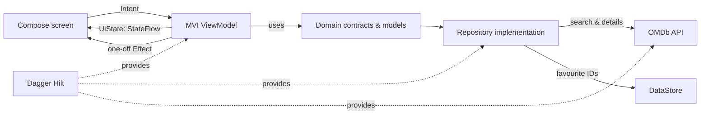

# 🎬 About Movie

**About Movie** is a small movie companion for those moments when you remember a scene, an actor, or only half a title—and need to find the film behind it. Search OMDb, skim the essentials, open the full story, and keep the movies worth returning to close at hand.

The app is intentionally modest in scope, but the code is not a throwaway sample. It is a practical, Compose-first Android project that shows how a search-and-detail experience can stay responsive, predictable, and easy to extend.

> **Version 2** is a ground-up modernization of the original app: XML, LiveData, RxJava, manual factories, and Kodein are gone. Compose, MVI, Flow, Hilt, and DataStore take their place.

## Screenshots

### The refreshed Compose experience

<p align="center">
  
  &nbsp;&nbsp;
  
</p>

The search screen keeps the catalogue one tap away, while the detail screen brings the story, cast, crew, release information, ratings, and awards together without feeling crowded.

### Original gallery

The original project screenshots are kept here too—they are part of the app’s journey.

<p align="center">
  
  
  
  
</p>

## What you can do

- Search the OMDb catalogue by title, with a few handy starting suggestions.
- Continue through results with server-backed pagination.
- Open a movie for its full plot, cast, crew, release information, awards, and IMDb rating.
- Save favourites locally; they remain saved after the app is closed.
- Recover gracefully from a bad connection or an empty search with clear retry states.

## A quick tour of the architecture

The app has two feature areas—**search** and **detail**—and both follow the same MVI conversation: the UI sends an intent, the ViewModel reduces it into a new immutable state, and Compose renders that state. One-off work such as navigation and snackbars is emitted as an effect rather than being smuggled into the screen state.



The direction is deliberate: the UI knows about presentation state, features depend on small domain contracts, and the data layer owns Retrofit and persistence details. That makes the app easier to test and gives new features somewhere sensible to live.

### The moving pieces

| Area | Responsibility |
| --- | --- |
| `ui/` | App navigation, Compose screens, Material 3 styling, and image rendering. |
| `feature/search` | Search intents, paging, favourites actions, search state, and navigation effects. |
| `feature/detail` | Detail loading, favourite actions, and the complete movie state. |
| `domain/` | Stable movie models and the repository contracts used by the features. |
| `data/` | OMDb Retrofit service, DTO-to-domain mapping, and DataStore-backed favourites. |
| `di/` | Hilt bindings and the network graph. |

## Why this approach?

Movie search is a nice fit for unidirectional state. A request can be loading, successful, empty, or unsuccessful; a user can type, submit, page, retry, open a movie, or favourite it. Keeping those actions and states explicit avoids the familiar tangle of view callbacks, mutable adapters, and “what happens after rotation?” bugs.

`StateFlow` is the screen’s source of truth, so Compose can safely recompose whenever the state changes. `DataStore` exposes favourites as a Flow too, which means a heart icon updates everywhere without a manual refresh. Hilt keeps construction out of Activities and ViewModels, leaving those classes focused on their actual jobs.

## Built with

- **Kotlin 2.0** with Coroutines and Flow
- **Jetpack Compose**, Material 3, and Navigation Compose
- **MVI** with immutable state, intents, and effects
- **Dagger Hilt** for dependency injection
- **Retrofit + OkHttp + Gson** for OMDb networking
- **Coil** for posters and **DataStore** for favourites
- **JUnit**, Gradle 8, and Android Gradle Plugin 8

## Run it locally

You will need Android Studio (or a local Android SDK) and JDK 17. The project includes the legacy demo key so it can run immediately. If you would rather use your own OMDb key, put this in `~/.gradle/gradle.properties`:

```properties
OMDB_API_KEY=your_omdb_key
```

Then clone and build:

```bash
git clone https://github.com/myofficework000/AboutMovie.git
cd AboutMovie
./gradlew testDebugUnitTest assembleDebug
```

The debug APK will be available at:

```text
app/build/outputs/apk/debug/app-debug.apk
```

## A note for contributors

When adding a feature, keep the same flow: define the feature’s state and intents first, make the ViewModel the single reducer of those intents, then let the Compose screen render the result. It keeps the app pleasantly unsurprising—both for the person using it and the next person reading the code.
